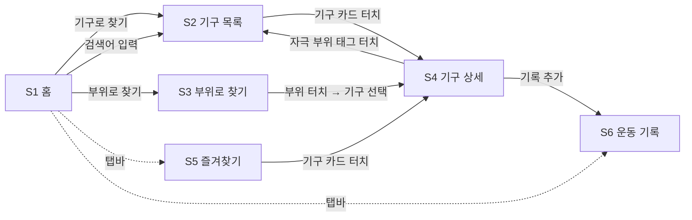
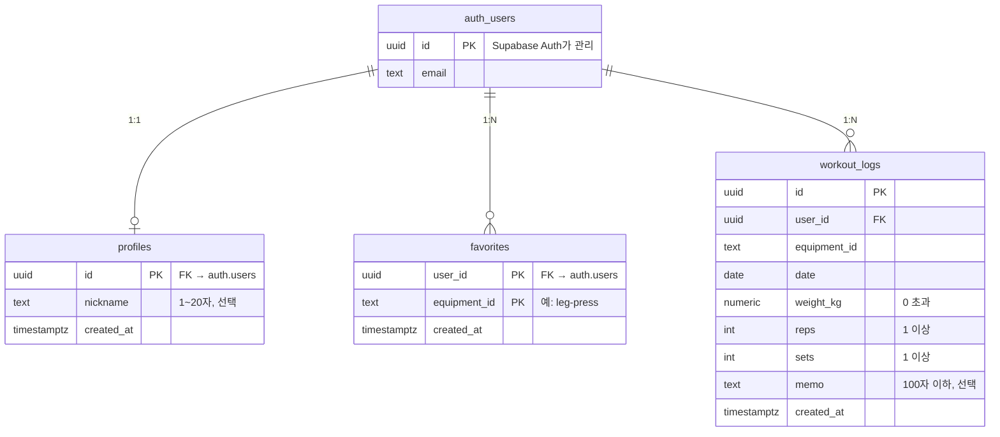

# PRD: 나만의 헬스도감

- 작성일: 2026-11-03
- 배포 마감: 2026-11-04
- 상태: 초안 (인터뷰 기반)

> **[미정]** 표시는 아직 정하지 않은 항목입니다. 8장에 모아 두었습니다.

---

## 1. 서비스 목적

### 1.1 한 줄 요약

헬스 입문자가 헬스장에서 폰으로 **기구별 운동 자세·자극 부위**를 바로 확인하고, 반대로 **운동하고 싶은 부위에 맞는 기구**를 쉽게 찾을 수 있는 모바일 웹 도감.

### 1.2 누구의 어떤 문제를 해결하는가

| 구분 | 내용 |
|---|---|
| 누구 | 헬스 입문자 |
| 문제 ① | 헬스장에서 기구 앞에 섰는데 **사용법을 몰라** 당황한다 |
| 문제 ② | 특정 근육을 운동하고 싶은데 **어떤 기구를 써야 할지 몰라** 검색을 헤맨다 |
| 해결 | 두 상황 모두 홈에서 **3번 이내 터치**로 답을 찾게 한다 |

### 1.3 사용 시나리오

1. **기구 → 자세:** 레그 프레스 앞에 선 입문자가 앱을 열고 "기구로 찾기" → 검색 또는 목록에서 레그 프레스 선택 → 자세 설명과 주의사항을 보며 운동한다.
2. **부위 → 기구:** 등 운동을 하고 싶은 입문자가 "부위로 찾기" → 인체 그림(뒷모습)에서 등을 터치 → 랫풀다운, 시티드 케이블 로우 등의 목록에서 하나를 고른다.

### 1.4 사용 환경

- 모바일 브라우저 우선 (헬스장 안에서 한 손으로 사용)
- 데스크톱에서도 레이아웃이 깨지지 않을 것

---

## 2. 핵심 화면

### 2.1 화면별 역할

| ID | 화면 | 경로 | 역할 |
|---|---|---|---|
| S1 | 홈 | `/` | 두 가지 찾기 방식 중 하나로 안내하는 출발점. 검색창 제공 |
| S2 | 기구 목록 | `/equipment` | 기구 20개를 카드로 보여주고 검색·부위 필터로 좁힌다 |
| S3 | 부위로 찾기 | `/muscles` | 앞·뒤 인체 그림에서 부위를 골라 해당 기구를 보여준다 |
| S4 | 기구 상세 | `/equipment/[slug]` | 사진, 운동 자세, 자극 부위, 주의사항을 보여준다 |
| S5 | 즐겨찾기 | `/favorites` | 저장한 기구 목록 |
| S6 | 운동 기록 | `/logs` | 날짜별 운동 기록 목록과 기록 추가 |
| S7 | 내 정보 | `/account` | 비로그인: 로그인/회원가입 폼, 로그인: 닉네임·이메일, 로그아웃 |

### 2.2 화면 구성

**S1 홈**
- 서비스 이름, 상단 검색창
- 큰 버튼 두 개: **기구로 찾기**, **부위로 찾기**
- 하단 탭바: 홈 / 즐겨찾기 / 운동 기록

**S2 기구 목록**
- 상단: 검색창, 부위 필터 칩 (전체 / 가슴 / 등 / 어깨 / 팔 / 복근 / 하체)
- 기구 카드: 사진 썸네일, 기구 이름, 주요 자극 부위 태그
- 결과가 없으면 "검색 결과가 없어요" 안내

**S3 부위로 찾기**
- 앞모습 / 뒷모습 전환 토글
- SVG 근육 지도: 부위를 터치하면 강조 표시 후 아래에 해당 기구 목록 표시
- 그림 아래에 부위 이름 버튼도 제공 (작은 부위를 누르기 어려울 때 대비)

**S4 기구 상세**
- 기구 사진과 출처 표기
- 기구 이름 (한글 / 영문)
- 자극 부위: 주동근·보조근 태그 + 작은 인체 그림에 해당 부위 강조
- 운동 자세 설명: 단계별 번호 목록
- 주의사항
- 즐겨찾기 버튼, "기록 추가" 버튼

**S5 즐겨찾기 / S6 운동 기록 / S7 내 정보**
- S5: 기구 카드 목록 (S2와 같은 카드 사용)
- S6: 날짜별 기록 목록. 기록 추가 폼 (기구, 무게, 횟수, 세트, 메모)
- S7: 로그인/회원가입 탭 폼. 로그인하면 닉네임, 이메일, 즐겨찾기·기록 수, 로그아웃 버튼. 하단 탭바의 "내 정보"로 들어간다

### 2.3 이동 흐름



- S4의 자극 부위 태그를 누르면 그 부위로 필터된 S2로 이동한다. (예: "햄스트링" → 햄스트링 기구 목록)
- 모든 화면에서 뒤로 가기와 하단 탭바로 홈·즐겨찾기·운동 기록에 갈 수 있다.

---

## 3. 요구사항

각 요구사항은 "사용자가 할 수 있어야 하는 일"과 "확인할 조건(완료 기준)"으로 정리한다.

### R1. 기구로 찾기

| ID | 사용자가 할 수 있어야 하는 일 | 확인할 조건 |
|---|---|---|
| R1-1 | 홈에서 기구 목록으로 이동한다 | "기구로 찾기"를 누르면 S2로 이동하고 기구 20개가 모두 보인다 |
| R1-2 | 기구 이름으로 검색한다 | "레그"를 입력하면 레그 프레스, 레그 익스텐션, 레그 컬만 보인다. 한글·영문 이름 모두 검색되고 대소문자·띄어쓰기를 무시한다 |
| R1-3 | 부위 필터로 목록을 좁힌다 | "등" 칩을 누르면 주동근 또는 보조근에 등 부위가 포함된 기구만 보인다. "전체"를 누르면 다시 20개가 보인다 |
| R1-4 | 검색과 필터를 함께 쓴다 | 두 조건을 모두 만족하는 기구만 보이고, 결과가 0개면 안내 문구가 보인다 |
| R1-5 | 홈 검색창에서 바로 검색한다 | 검색어를 입력하고 엔터를 누르면 그 검색어가 적용된 S2로 이동한다 |

### R2. 부위로 찾기

| ID | 사용자가 할 수 있어야 하는 일 | 확인할 조건 |
|---|---|---|
| R2-1 | 인체 그림을 앞·뒤로 전환한다 | 토글을 누르면 앞모습/뒷모습 그림이 바뀐다 |
| R2-2 | 그림에서 부위를 터치한다 | 터치한 부위가 색으로 강조되고, 그 부위 기구 목록이 아래에 나타난다 |
| R2-3 | 부위 이름 버튼으로도 고른다 | 버튼을 누르면 R2-2와 같은 결과가 나온다 |
| R2-4 | 목록에서 기구를 고른다 | 기구를 누르면 S4로 이동한다 |

### R3. 기구 상세

| ID | 사용자가 할 수 있어야 하는 일 | 확인할 조건 |
|---|---|---|
| R3-1 | 기구 정보를 확인한다 | 사진, 이름(한글/영문), 자극 부위, 단계별 자세 설명, 주의사항이 모두 보인다 |
| R3-2 | 사진 출처를 확인한다 | 사진 아래에 출처(작가, 사이트)가 표기된다 |
| R3-3 | 자극 부위를 그림으로 확인한다 | 작은 인체 그림에 주동근·보조근이 다른 색으로 강조된다 |
| R3-4 | 같은 부위의 다른 기구로 이동한다 | 부위 태그를 누르면 해당 부위로 필터된 S2로 이동한다 |
| R3-5 | 주소로 바로 접근한다 | `/equipment/leg-press` 같은 주소를 직접 열어도 상세가 보이고, 없는 주소는 404 안내가 보인다 |

### R4. 즐겨찾기

| ID | 사용자가 할 수 있어야 하는 일 | 확인할 조건 |
|---|---|---|
| R4-1 | 기구를 즐겨찾기에 추가·해제한다 | S4의 버튼을 누르면 상태가 바뀌고 아이콘이 채워지거나 비워진다 |
| R4-2 | 즐겨찾기 목록을 본다 | S5에 추가한 기구만 보이고, 없으면 "아직 즐겨찾기한 기구가 없어요" 안내가 보인다 |
| R4-3 | 다시 열어도 유지된다 | 새로고침하거나 브라우저를 다시 열어도 즐겨찾기가 남아 있다 (이번 범위: 같은 기기·브라우저 기준) |

### R5. 운동 기록

| ID | 사용자가 할 수 있어야 하는 일 | 확인할 조건 |
|---|---|---|
| R5-1 | 운동 기록을 추가한다 | 기구, 무게(kg), 횟수, 세트, 메모(선택)를 입력해 저장하면 목록 맨 위에 나타난다 |
| R5-2 | 잘못된 값을 막는다 | 기구 미선택, 0 이하 또는 숫자가 아닌 무게·횟수·세트는 저장되지 않고 안내가 보인다 |
| R5-3 | 날짜별로 기록을 본다 | 기록이 날짜별로 묶여 최신 날짜가 위에 보인다 |
| R5-4 | 기록을 삭제한다 | 삭제를 확인하면 목록에서 사라진다 |
| R5-5 | 상세에서 바로 기록한다 | S4의 "기록 추가"를 누르면 해당 기구가 선택된 상태로 기록 폼이 열린다 |

### R6. 로그인

| ID | 사용자가 할 수 있어야 하는 일 | 확인할 조건 |
|---|---|---|
| R6-1 | 회원가입·로그인한다 | 가입 후 로그인하면 상단에 로그인 상태가 보인다 |
| R6-2 | 로그아웃한다 | 로그아웃하면 로그인 전 상태로 돌아간다 |
| R6-3 | 기기를 바꿔도 내 데이터가 유지된다 | 다른 기기에서 같은 계정으로 로그인하면 즐겨찾기와 운동 기록이 그대로 보인다 |

### R7. 공통 (비기능)

| ID | 요구사항 | 확인할 조건 |
|---|---|---|
| R7-1 | 모바일 우선 | 375px 너비에서 가로 스크롤 없이 보이고, 터치 영역은 최소 44px |
| R7-2 | 빠른 표시 | 기구 목록·상세는 서버 호출 없이 바로 표시된다 (정적 생성) |
| R7-3 | 배포 | 2026-11-04까지 Vercel URL로 누구나 접속할 수 있다 |

---

## 4. 이번 구현 범위

이번에는 **백엔드 없이 목업 데이터로 모든 화면과 동작을 구현해 배포**한다. 실제 서버가 있어야만 가능한 기능은 다음 단계로 분리하되, 나중에 저장소만 바꿔 끼울 수 있도록 데이터 접근 코드를 한곳에 모은다.

### 4.1 목업 데이터로 구현 (이번 범위)

| 화면·동작 | 요구사항 | 구현 방식 |
|---|---|---|
| 홈, 기구 목록, 검색, 부위 필터 | R1 | 코드 안의 정적 기구 데이터 (`data/equipment.ts`)를 브라우저에서 필터링 |
| 부위로 찾기 (인체 그림) | R2 | 직접 만든 앞·뒤 SVG + 정적 부위 데이터 (`data/muscles.ts`) |
| 기구 상세 | R3 | 기구 20개 페이지를 빌드할 때 정적 생성 |
| 즐겨찾기 | R4-1 ~ R4-3 | 브라우저 `localStorage`에 저장 (같은 기기에서만 유지) |
| 운동 기록 | R5-1 ~ R5-5 | 브라우저 `localStorage`에 저장 (같은 기기에서만 유지) |
| 공통 | R7 | 모바일 우선 반응형, Vercel 배포 |

### 4.2 나중에 백엔드가 필요한 기능

| 기능 | 요구사항 | 백엔드가 필요한 이유 | 계획 |
|---|---|---|---|
| 로그인/회원가입 | R6-1, R6-2 | 사용자 인증과 계정 관리 | Supabase Auth |
| 기기 간 데이터 동기화 | R6-3 | 즐겨찾기·기록을 서버에 저장해야 다른 기기에서 보인다 | Supabase DB로 `localStorage` 대체 |
| 관리자 기능 | – | 기구 데이터를 웹에서 추가·수정하려면 DB와 권한 관리 필요 | 기구 데이터를 DB로 이전 후 구현 |
| 운동 영상 | – | 영상 저장·제공 (외부 링크라면 백엔드 없이도 가능) | 기구 데이터에 `videoUrl` 추가 |

S7 화면은 백엔드 연동 단계(10장)에서 추가했다.

### 4.3 백엔드 전환을 위한 설계

- 즐겨찾기·운동 기록은 화면에서 `localStorage`를 직접 쓰지 않고 저장소 모듈(`lib/storage/`)을 거친다. 백엔드 연동 시 이 모듈의 구현만 Supabase로 바꾼다.
- 로그인 후 처음 동기화할 때 `localStorage`에 있던 데이터를 서버로 옮긴다.

### 4.4 데이터 모델

**기구 (정적 데이터)**

```ts
type Equipment = {
  id: string;
  slug: string;              // URL용, 예: "leg-press"
  nameKo: string;
  nameEn: string;
  imageUrl: string;
  imageCredit: { author: string; source: string; url: string };
  primaryMuscles: MuscleId[];   // 주동근
  secondaryMuscles: MuscleId[]; // 보조근
  steps: string[];              // 운동 자세 설명 (단계별)
  cautions: string[];           // 주의사항
  videoUrl?: string;            // 나중에
};
```

**즐겨찾기·운동 기록 (이번: `localStorage`, 나중: Supabase 테이블)**

```ts
type Favorite = { equipmentId: string; createdAt: string };

type WorkoutLog = {
  id: string;
  equipmentId: string;
  date: string;      // YYYY-MM-DD
  weightKg: number;
  reps: number;
  sets: number;
  memo?: string;
};
```

나중에 Supabase로 옮길 때는 두 테이블에 `user_id`를 추가한다.

### 4.5 부위 분류

| 대분류 (필터 칩) | 세부 부위 | 인체 그림 |
|---|---|---|
| 가슴 | 대흉근 | 앞 |
| 어깨 | 전면·측면 삼각근 / 후면 삼각근 | 앞 / 뒤 |
| 등 | 광배근, 승모근, 척추기립근 | 뒤 |
| 팔 | 이두근 / 삼두근 | 앞 / 뒤 |
| 복근 | 복직근 | 앞 |
| 하체 | 대퇴사두근, 내전근 / 둔근, 햄스트링, 종아리 | 앞 / 뒤 |

### 4.6 초기 데이터: 대표 기구 20개 (확정)

| # | 기구 | 주요 부위 |
|---|---|---|
| 1 | 체스트 프레스 머신 | 가슴 |
| 2 | 펙덱 플라이 머신 | 가슴 |
| 3 | 플랫 벤치프레스 | 가슴 |
| 4 | 인클라인 벤치프레스 | 가슴(윗가슴) |
| 5 | 케이블 크로스오버 | 가슴, 삼두 |
| 6 | 랫풀다운 머신 | 등 |
| 7 | 시티드 케이블 로우 | 등 |
| 8 | 어시스트 풀업/딥스 머신 | 등, 삼두 |
| 9 | 백 익스텐션 벤치 | 척추기립근, 둔근 |
| 10 | 숄더 프레스 머신 | 어깨 |
| 11 | 레터럴 레이즈 머신 | 어깨(측면) |
| 12 | 스미스 머신 | 하체, 가슴, 어깨 |
| 13 | 레그 프레스 | 하체 |
| 14 | 레그 익스텐션 | 대퇴사두근 |
| 15 | 레그 컬 | 햄스트링 |
| 16 | 핵 스쿼트 머신 | 하체 |
| 17 | 힙 어브덕션/어덕션 머신 | 둔근, 내전근 |
| 18 | 프리처 컬 머신 | 이두 |
| 19 | 카프 레이즈 머신 | 종아리 |
| 20 | 앱도미널 크런치 머신 | 복근 |

2026-11-03에 위 목록으로 확정했다.

### 4.7 이미지

- **인체 그림:** 앞·뒤 모습 SVG 근육 지도를 직접 제작한다. 부위별 `path`에 부위 id를 붙여 터치·강조를 처리한다.
- **기구 사진:** Unsplash, Pixabay 등 무료 라이선스 이미지를 사용하고, 출처를 `imageCredit`에 기록해 상세 화면에 표기한다.

---

## 5. 프레임워크 선택과 근거

### 5.1 선택

| 영역 | 선택 |
|---|---|
| 프레임워크 | **Next.js (App Router) + TypeScript** |
| 스타일 | Tailwind CSS |
| 배포 | Vercel |
| 백엔드 (다음 단계) | Supabase (Auth + PostgreSQL) |
| 개발 방식 | Claude Code 활용 |

### 5.2 선택 근거

1. **하루 안에 배포해야 한다:** Next.js는 라우팅, 빌드, 이미지 최적화가 기본으로 들어 있어 설정에 쓰는 시간이 적다. Vercel은 Next.js를 만든 회사의 서비스라 GitHub 저장소를 연결하면 푸시만으로 배포된다.
2. **기구 상세 20개를 정적 페이지로 만들 수 있다:** `generateStaticParams`로 빌드할 때 상세 페이지를 미리 만들어, 헬스장처럼 통신이 느린 곳에서도 빨리 열리고 주소로 바로 접근할 수 있다(R3-5, R7-2).
3. **목업에서 백엔드로 자연스럽게 확장된다:** 이번에는 정적 데이터와 `localStorage`로 동작하고, 다음 단계에서 같은 프로젝트에 Supabase를 붙이면 된다. 프레임워크를 바꿀 필요가 없다.
4. **Supabase는 로그인과 DB를 한 번에 제공한다:** 인증과 PostgreSQL을 함께 주고 Next.js 공식 연동 가이드가 있어, 별도 서버를 만들지 않고 R6을 구현할 수 있다.
5. **개발 경험과 맞는다:** Claude Code로 프론트엔드·백엔드·배포를 해 본 경험이 있고, Next.js는 자료가 많아 AI 도움을 받기 좋다.
6. **TypeScript + Tailwind:** 기구 데이터 구조를 타입으로 고정해 20개 데이터의 누락을 막고, Tailwind로 모바일 반응형을 빠르게 만든다.

### 5.3 검토했지만 고르지 않은 대안

| 대안 | 고르지 않은 이유 |
|---|---|
| Vite + React | 가볍지만 라우팅과 정적 페이지 생성을 따로 구성해야 한다 |
| 순수 HTML/CSS/JS | 화면 7개와 상태 관리(즐겨찾기, 기록)를 직접 관리하기 번거롭다 |
| Firebase | Supabase와 비슷하지만 운동 기록처럼 날짜별 조회가 많은 데이터는 SQL 쪽이 다루기 쉽다 |

---

## 6. 일정 (2026-11-03 ~ 11-04)

| 순서 | 작업 | 범위 |
|---|---|---|
| 1 | PRD 확정 | – |
| 2 | Next.js 프로젝트 생성, Vercel 연결 | 이번 |
| 3 | 기구 20개 목업 데이터 작성 (자세, 부위, 주의사항, 이미지 출처) | 이번 |
| 4 | 홈, 기구 목록, 검색, 부위 필터 | 이번 |
| 5 | 기구 상세 | 이번 |
| 6 | SVG 인체 그림과 부위로 찾기 | 이번 |
| 7 | 즐겨찾기, 운동 기록 (`localStorage`) | 이번 |
| 8 | 모바일 확인 후 배포 | 이번 |
| 9 | DB 설계 (10장) | 백엔드 |
| 10 | Supabase 프로젝트 생성, 스키마·RLS 적용, 환경변수 등록 | 백엔드 |
| 11 | 로그인/회원가입 화면, 즐겨찾기·기록을 Supabase로 전환 | 백엔드 |

## 7. 성공 기준

- 입문자가 홈에서 **3번 이내 터치**로 원하는 기구의 자세 설명에 도달한다.
- 인체 그림에서 부위를 누르면 해당 기구 목록이 나온다.
- 즐겨찾기와 운동 기록이 새로고침 후에도 유지된다.
- 375px 모바일 화면에서 레이아웃이 깨지지 않는다.
- 2026-11-04까지 Vercel에 배포되어 누구나 URL로 접속할 수 있다.

## 8. 미정 항목

| 항목 | 메모 |
|---|---|
| **[미정]** 운동 기록 입력 항목 | 현재: 무게·횟수·세트·메모. 세트별 무게 기록이 필요한지 |
| **[미정]** 디자인 톤 | 색상, 다크 모드 지원 여부 |
| **[미정]** 서비스 주소 | Vercel 기본 도메인 사용 여부 |

## 9. 리스크

| 리스크 | 대응 |
|---|---|
| 하루 안에 모든 화면을 못 끝냄 | 기구 찾기(R1~R3)를 먼저 배포하고 즐겨찾기·기록(R4~R5)을 이어서 추가 |
| `localStorage` 데이터는 기기·브라우저를 바꾸면 사라짐 | 화면에 "이 기기에만 저장돼요" 안내. 백엔드 연동 시 서버로 이전 |
| 무료 이미지 라이선스 조건 | 상업적 이용·출처 표기 조건을 확인하고 출처를 기록 |
| 운동 자세 설명의 정확성 | 일반적으로 알려진 자세 기준으로 작성하고, 부상 위험 관련 주의사항을 반드시 포함 |
| SVG 인체 그림의 작은 부위 터치 어려움 | 부위 이름 버튼을 함께 제공 |
| 이메일 인증을 끈 상태에서는 남의 이메일로도 가입 가능 | 이메일로 무언가를 보내는 기능이 없어 영향이 작음. 정식 서비스 전에 SMTP를 붙이고 인증을 켬 |

---

## 10. 백엔드 설계 (Supabase)

2026-11-03 확정. 4.2의 "나중에 백엔드가 필요한 기능" 중 로그인과 데이터 동기화를 구현하기 위한 설계다.

### 10.1 결정 사항

| 항목 | 결정 |
|---|---|
| 로그인 방식 | **이메일 + 비밀번호** (Supabase Auth). Google 로그인은 나중에 추가 |
| 이메일 인증 | **지금은 끄고 나중에 켠다.** 무료 플랜 기본 메일은 발송 한도가 작아 테스트·배포 일정에 방해가 된다. 정식 서비스 전에 SMTP를 연결하고 켠다 |
| 기구 데이터 | 계속 코드(`data/equipment.ts`)에 둔다. 관리자 기능을 만들 때 `equipment` 테이블로 옮긴다 |
| 데이터 보호 | 모든 테이블에 **RLS**를 켜고 "로그인한 본인 데이터만" 접근하게 한다 |

### 10.2 민감 정보와 환경변수

- **사용자 비밀번호는 우리 DB와 환경변수 어디에도 저장하지 않는다.** Supabase Auth가 `auth.users`에 해시로 저장한다.
- Supabase 연결 정보는 환경변수로 관리한다. 예시는 `.env.example`에 있다.

| 변수 | 노출 | 설명 |
|---|---|---|
| `NEXT_PUBLIC_SUPABASE_URL` | 브라우저에 노출 가능 | 프로젝트 주소 |
| `NEXT_PUBLIC_SUPABASE_PUBLISHABLE_KEY` | 브라우저에 노출 가능 | 공개 키. 데이터 보호는 RLS가 담당 |
| `SUPABASE_SECRET_KEY` | **노출 금지** | RLS를 무시하는 관리자 키. 이번 범위에서는 사용하지 않음 |

- 로컬: `.env.local` (`.gitignore`에 포함되어 커밋되지 않음)
- 배포: Vercel 대시보드의 Environment Variables에 등록

### 10.3 테이블



| 테이블 | 설명 |
|---|---|
| `profiles` | 닉네임 표시용. 가입 시 트리거(`handle_new_user`)가 자동 생성 |
| `favorites` | `(user_id, equipment_id)` 기본키로 중복 즐겨찾기 방지 |
| `workout_logs` | 화면의 입력 검사(R5-2)를 DB 제약조건으로도 적용. `(user_id, date)` 인덱스로 날짜별 조회 |

- 모든 테이블은 `auth.users` 삭제 시 `on delete cascade`로 함께 삭제된다.
- `equipment_id`는 외래키 대신 형식(`^[a-z0-9-]{1,64}$`)만 DB에서 검사하고, 실제 존재 여부는 앱에서 검사한다.
- SQL: `supabase/migrations/20261103000000_init.sql`

### 10.4 RLS 정책

조건은 모두 `(select auth.uid()) = user_id` (profiles는 `= id`)이며, 비로그인 사용자(`anon`)는 테이블 권한 자체를 회수한다.

| 테이블 | 조회 | 추가 | 수정 | 삭제 |
|---|---|---|---|---|
| profiles | 본인 | ✕ (트리거가 생성) | 본인 | ✕ (계정 삭제 시 cascade) |
| favorites | 본인 | 본인 | ✕ | 본인 |
| workout_logs | 본인 | 본인 | 본인 | 본인 |

### 10.5 확인할 조건

| ID | 조건 |
|---|---|
| B-1 | 비로그인 상태로 API를 호출하면 세 테이블 모두 데이터를 읽거나 쓸 수 없다 |
| B-2 | 사용자 A로 로그인해 사용자 B의 기록을 조회·수정·삭제하려 하면 결과가 0건이다 |
| B-3 | 다른 사람의 `user_id`로 기록을 추가하면 거부된다 |
| B-4 | 무게 0, 횟수 0, 101자 메모를 넣으면 DB가 거부한다 |
| B-5 | 가입하면 `profiles` 행이 자동으로 생긴다 |
| B-6 | 계정을 삭제하면 그 사용자의 즐겨찾기·기록도 삭제된다 |

### 10.6 로그인 전 데이터 처리

로그인 전에는 지금처럼 `localStorage`를 사용한다. 처음 로그인하면 `localStorage`의 즐겨찾기·기록을 서버로 옮기고 브라우저 데이터를 비운다. (4.3 참고)
